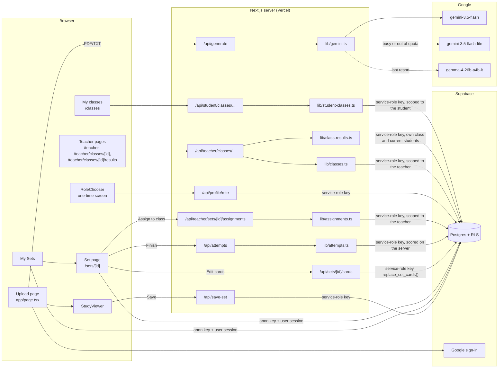

# FlashForge architecture

How the app works, end to end. For setup, see the [README](../README.md); for the
database, see [supabase/README.md](../supabase/README.md).

## Overview



Every server route that changes data checks the caller first (`lib/roles.ts`) and then
writes with the service-role key. Browsers read only what RLS allows (section 4).

### API routes

| Method and path | Who | What it does |
|---|---|---|
| `POST /api/generate` | Anyone | Extract text from a PDF/TXT and generate 10 study items (section 1) |
| `POST /api/save-set` | Signed in | Save a generated study guide to the user's account |
| `PUT /api/sets/[id]/cards` | The set's owner | Save edited cards: `{ cards: [{ id?, question, answer, options? }] }` in display order (#55) |
| `POST /api/profile/role` | Signed in, not chosen yet | One-time choice: `{ role: 'student' \| 'teacher' }` (#52) |
| `GET /api/teacher/classes` | Teacher, admin | The caller's classes, newest first, with student counts |
| `POST /api/teacher/classes` | Teacher, admin | Create a class: `{ name }` → the class with its join code |
| `GET /api/teacher/classes/[id]` | The class's teacher | Class details, roster (names, emails, join dates) and assignments (#56) |
| `GET /api/teacher/classes/[id]/results` | The class's teacher | Every current student × assignment: best and latest score, attempts, done / late / not started, and each assignment's class average (#58) |
| `PATCH /api/teacher/classes/[id]` | The class's teacher | Rename: `{ name }` |
| `DELETE /api/teacher/classes/[id]` | The class's teacher | Delete the class and its memberships |
| `POST /api/teacher/classes/[id]/join-code` | The class's teacher | Replace the join code; the old one stops working |
| `GET /api/teacher/classes/[id]/students/[studentId]` | The class's teacher | One student's attempts on the class's assignments, grouped by assignment, newest first; 404 if they aren't in the class (#58) |
| `DELETE /api/teacher/classes/[id]/students/[studentId]` | The class's teacher | Remove one student from the class |
| `GET /api/student/classes` | Student | The classes the caller joined, most recent first, with teacher names and each class's assignments (#56), each with the caller's own `myProgress` (#57) |
| `POST /api/student/classes` | Student | Join with a code: `{ code }` (any case, spaces or hyphen) → 201 joined, or 200 `alreadyMember` |
| `DELETE /api/student/classes/[id]` | Student in that class | Leave the class |
| `GET /api/teacher/sets/[id]/assignments` | The set's owner (teacher, admin) | The owner's classes, marking which already have this set (#56) |
| `POST /api/teacher/sets/[id]/assignments` | The set's owner (teacher, admin) | Assign: `{ classIds, dueAt \| null }` → `{ assigned, alreadyAssigned }` |
| `PATCH /api/teacher/classes/[id]/assignments/[assignmentId]` | The class's teacher | Change the due date: `{ dueAt \| null }` |
| `DELETE /api/teacher/classes/[id]/assignments/[assignmentId]` | The class's teacher | Unassign; students lose access right away |
| `POST /api/attempts` | Signed in, can open the set | Save a finished study session: `{ id, setId, assignmentId?, answers }` → 201 with the scored attempt, or 200 if that `id` was already saved (#57) |
| `GET /api/attempts?setId=…` | Signed in | The caller's own 10 most recent attempts on that set, newest first |

Errors are JSON `{ error }` with 400 (bad input), 401 (not signed in), 403 (wrong role),
404 (not found, *or* someone else's class), 409 (conflict, e.g. a role already chosen or
the 50-class limit), 429 (too many wrong join codes; includes a `Retry-After` header), and
500 (a generic message; details only go to the server log).

### Page layout

The root `<body>` is a flex column (`app/layout.tsx`), so a centered `<main>`
(`max-w-* mx-auto`) sizes to its content. Pages with one-line text that can be long
(`truncate`) add `w-full` to it; otherwise a long title makes the page wider than a phone
screen instead of shortening with "…".

## 1. Generating a study guide

1. **Upload** (`app/page.tsx`): the user picks *Flashcards* or *Multiple Choice* and
   drops a `.pdf` or `.txt` file. Nothing is saved yet.
2. **`POST /api/generate`** (`app/api/generate/route.ts`, `maxDuration = 90`):
   - Extracts text: PDFs with `unpdf`, TXT as UTF-8. Unreadable files get HTTP 422
     with a friendly message.
   - Calls `generateStudyItems(text, studyType)` and returns
     `{ title, sourceFilename, studyType, items, model }`.
   - Never sends raw API errors to the browser; details go to the server log.
3. **Show it**: the upload page swaps to `StudyViewer` on the **same URL** (`/`), so
   *Exit* clears the result instead of navigating (it asks first if the guide isn't saved).
   After 15 seconds of waiting, the page explains that a slower backup AI may be in use.
4. **Save** (optional, requires sign-in): `POST /api/save-set` verifies the user's token
   and inserts the set and cards with the **service-role** key. If the user signs in
   mid-save, the unsaved result is kept in `sessionStorage` across the Google redirect
   and saved automatically afterwards.

### The AI pipeline (`lib/gemini.ts`)

**Model chain.** Models are tried in order, and each has its own free-tier quota:

| # | Model | Attempts | Timeout per attempt | Notes |
|---|---|---|---|---|
| 1 | `gemini-3.5-flash` | 2 | 25s | Main model. `thinkingLevel: 'low'` for speed |
| 2 | `gemini-3.5-flash-lite` | 2 | 25s | Same request; separate quota |
| 3 | `gemma-4-26b-a4b-it` | 1 | 40s | Last resort: slow (~26–33s) and sometimes fails |

- The whole generation is capped at **75 seconds**.
- **429 (quota used up)** skips straight to the next model.
- **503/5xx, timeouts, network errors, and empty or invalid output** are retried with
  exponential backoff plus jitter.
- **Other 4xx errors** (bad request, bad key) fail immediately.
- Users only ever see "The AI is busy right now…" or a generic error message.

**Why Gemma needs a different request.** We tested this on 2026-10-20:

| Setting | Gemini | Gemma 4 |
|---|---|---|
| `responseSchema` | Used | HTTP 500 |
| `thinkingConfig` | `thinkingLevel: 'low'` | HTTP 400 |
| `responseJsonSchema` | Not used | Fast, but outputs garbage ("Taxonomy-set-3-A-R-C", repeated phrases, HTML) |
| Plain JSON mode | Not used | **Used.** The format goes in the prompt; Gemma "thinks" first, and those thought parts are skipped |

**Prompts.**
- *Flashcards* are identification-style: the question is a clue or definition and the
  answer is the 1–4 word term. "Explain/describe/why/how" questions aren't allowed.
- *Multiple choice*: 4 options, wrong options of the same kind as the answer, and no
  "all/none of the above". The prompt asks for 12 items so that 10 are left after
  validation.
- Only the first 30,000 characters of the file are used (#38 tracks sampling the whole
  document).

**Validation**, applied to every model's output:
- Thought parts and ```` ```json ```` fences are stripped before parsing.
- **Garbage filter:** rejects HTML, a short chunk repeated 4+ times, slug-like tokens,
  long whitespace runs, and over-long text. Flashcard answers over 8 words are dropped.
- **Multiple choice:** options are trimmed and de-duplicated, exactly 4 are required,
  the answer must match exactly one option (ignoring case and spacing, and then stored
  as that option's text), and options are shuffled in code. The matching rule is
  `normalizeChoice()` in `lib/card-rules.ts`, shared with the card editor.
- Fewer than **6** valid items counts as a failed attempt, so the next model is tried.

### Editing a saved study set (#55)

- The set's owner sees **✏️ Edit cards** on `/sets/[id]`. `components/CardEditor.tsx`
  lets them change questions and answers, delete cards, add cards (up to 50) and reorder
  them. For multiple choice they edit the 4 choices and pick the correct one with a radio
  button. Cancel asks first if anything changed.
- **Saving is all at once.** `PUT /api/sets/[id]/cards` gets the whole list in display
  order: cards with an `id` are kept and updated, cards without one are new, and the
  set's other cards are deleted.
- **One set of rules on both sides:** `validateCards()` in `lib/card-rules.ts` runs in
  the editor before sending and again on the server. Every card needs a question (up to
  500 characters) and an answer (up to 200). A multiple-choice card needs exactly 4
  different choices (compared with `normalizeChoice`) with one marked correct, and the
  answer is stored as that choice's text. Errors name the card ("Card 3: write a
  question.") and come back with a `cardIndex` so the editor can outline that card.
- **Only the owner, checked twice:** the route looks the set up with `user_id = caller`
  (`lib/sets.ts`, so others get 404, including admins and legacy ownerless sets). Then
  `public.replace_set_cards()` re-checks the owner.
- **All or nothing:** `replace_set_cards()` is one transaction. It locks the set's row so
  two saves queue up, rejects card ids that aren't in this set and ids sent twice (the
  route answers 409 "Reload the page"), then applies the update, insert and delete.
  **Edited cards keep their ids**, so study results (#57) and most-missed questions
  (#59) can refer to them. Only the service role may call it.

## 2. Auth and roles

- **Sign-in:** Google OAuth through Supabase (`lib/auth.ts`). Anyone can generate and
  study without signing in; saving requires sign-in.
- **Roles** (`public.profiles.role`): `student` (default), `teacher`, `admin`.
  - A trigger on `auth.users` creates a student profile at sign-up. It catches its own
    errors, so it can never block a sign-up.
  - Users can read their own profile and change only `display_name`, through a
    column-level grant. **They can never change their own role.**
  - The first admins come from `supabase/seed-admins.sql`; later ones will be added
    in-app (#60).
- **Choosing a role at sign-up** (#52):
  - `components/ProfileProvider.tsx` (in the root layout) loads the user's own profile,
    which RLS allows, and shares it with every page through `useProfile()`.
  - `components/RoleChooser.tsx` shows a one-time "student or teacher?" screen to any
    signed-in user who is still a default student with an empty `role_chosen_at`. That
    includes existing users on their next visit. It sits on top of the current page
    instead of navigating, so a save that's finishing after the Google redirect keeps
    running.
  - `POST /api/profile/role` accepts only `student` or `teacher`, and only once. It
    updates the row only `where role = 'student' and role_chosen_at is null`, so it can't
    overwrite a role an admin assigned, and two parallel requests can't both succeed. If
    the profile row is missing, it inserts one.
  - Responses: 401 not signed in, 400 any other role (including `admin`), 409 already
    chosen. Teachers then land on `/teacher`; students stay where they are.
- **Server checks** (`lib/roles.ts`): `requireRole(req, ['teacher', 'admin'])` reads the
  Bearer token and returns the user, or throws `AuthError` with 401 (not signed in) or
  403 (wrong role). A user without a profile counts as a student. Every teacher and
  admin route must use it, because hiding UI is not protection.

### Classes (#53)

- Teachers (and admins) create classes on `/teacher`. Each class gets a **join code**:
  6 characters from an alphabet without look-alikes (no `0/O`, `1/I/L`), stored as
  `K7M2QX` and shown as `K7M-2QX`. A unique constraint guarantees one class per code;
  on a clash the server simply tries a new random code.
- **All class changes go through `/api/teacher/classes/...`** routes, which call
  `requireRole(req, ['teacher', 'admin'])` and then `lib/classes.ts`. Every query there
  filters on `teacher_id = <caller>`, so another teacher's class behaves exactly like a
  missing one (404). There are no write grants or policies for browsers.
- **Get a new code** replaces it right away. The old code stops working, and students
  already in the class stay in it.
- The roster (names **and emails**) comes from `public.class_roster(class, teacher)`, a
  database function only the service role may call. It returns nothing unless the
  teacher owns the class.
- A teacher can have at most 50 classes (`MAX_CLASSES_PER_TEACHER`), since anyone can
  pick "teacher" at sign-up.
- **Admins** can use all teacher features, but only on classes they created themselves.
  Seeing other teachers' classes would be an admin feature (#60/#61).

### Joining a class (#54)

- Students open **My classes** (`/classes`, linked in the upload page header) and type a
  code. Case, spaces and the hyphen don't matter (`k7m 2qx` → `K7M2QX`, using
  `normalizeJoinCode`). Before joining, the page says: *"Your teacher will see your name,
  email, and your scores on this class's assignments."*
- `POST /api/student/classes` looks the code up on the server, with the service role. So
  codes can't be listed or guessed through the database API: browsers have no access to
  other classes' rows at all.
- **Students only:** teachers and admins get 403 (they manage classes, they don't join them).
- **Joining twice changes nothing.** The (`class_id`, `student_id`) primary key rejects
  the second row, which the route reports as `alreadyMember`.
- **Guessing limit:** each wrong code (a valid format, but no class has it) is saved in
  `class_join_failures`. After **10 wrong codes in 15 minutes**, the route answers 429
  until the oldest one falls out of the window. That's checked *before* the lookup, so
  even a correct code waits. Codes with an impossible format are rejected (400) without
  counting. This is stored in the database because Vercel runs many server instances
  that don't share memory.
- **Leaving** (`DELETE /api/student/classes/[id]`) removes only the caller's own
  membership. Rejoining needs the class's current code.

### Assigning sets to classes (#56)

- On a set they own, teachers (and admins) get **📌 Assign to class**
  (`components/AssignPanel.tsx`). It lists their classes, with ones that already have
  the set shown as assigned, and takes an optional due date. A set is assigned to a
  class at most once (unique `class_id, set_id`), so assigning again reports
  `alreadyAssigned` and leaves the existing due date alone.
- **Only the owner's own sets, to their own classes:** `lib/assignments.ts` checks
  `flashcard_sets.user_id` and `classes.teacher_id` against the caller. If any class in
  the list isn't theirs, nothing is assigned (404).
- On the class page, teachers see **Assigned sets**, soonest due first, with an
  **Overdue** badge. They can change or remove the due date, or **Unassign**.
- **Due dates** (`lib/due-dates.ts`) are stored as timestamps and always shown in the
  viewer's own time zone (`toLocaleString`). The server accepts no date, or a date that
  hasn't passed (5-minute grace) and is within 2 years.
- **Students** see each class's assigned sets on **My classes**, with the due date and an
  Overdue badge (or **Done**, see #57 below), and open them on `/sets/[id]`. They can't
  edit them.
- **Access follows the assignment (RLS):** a new `flashcard_sets` policy lets a user read
  a set while it's assigned to a class they're in (`private.is_assigned_to_me()`). Cards
  are now readable exactly when their set is. Unassigning, leaving the class, or the
  teacher deleting the set or class removes access immediately.
### Study results (#57)

- **Every finish on a saved set is saved** for signed-in users. `StudyViewer` reports what
  the student did (`onComplete`) and the set page sends it to `POST /api/attempts`.
  Signed-out visitors can still study; the finish screen asks them to sign in to save
  scores. A freshly generated guide that isn't saved yet records nothing.
- **Flashcards are self-marked.** After flipping a card the student taps **✓ Got it** or
  **✗ Missed it**, which moves on to the next card. Cards skipped with *Next* count as
  not marked (and not correct). The finish screen shows "*n* / *total* got it".
  Multiple choice is scored as before.
- **The server does the scoring** (`lib/attempts.ts`). The browser sends only card ids
  and what was picked (or the marks). The server checks that the caller can open the set
  (they own it, it's a legacy set, or it's assigned to a class they're in: the same rule
  as RLS), compares each pick with the real answer using `normalizeChoice`, and stores
  the score plus a per-card `answers` list. Answers for cards that no longer exist are
  dropped; if none are left (the owner rewrote the set mid-study), the route answers 409.
- **Retries can't double-count.** The browser makes a new id (`newId()`) for each finish.
  Sending the same id again returns the saved attempt (200) instead of adding one, and
  an id that belongs to someone else is refused (409).
- **Linking to an assignment:** links on My classes carry `?assignment=<id>`. The attempt
  is linked only if that assignment is for this set and the student is in its class;
  otherwise it's saved as private study. The finish screen says which: *"Your teacher
  can see it"* or *"Only you can see this one."*
- **Recent scores:** after saving, the finish screen lists the student's last 10 results
  on that set (`GET /api/attempts`).
- **Done / not done:** `GET /api/student/classes` adds `myProgress` (number of attempts,
  best score, last finish) to each assignment, and My classes shows **Done · best 8/10**
  in place of the Overdue badge. Finishing after the due date still counts as done.
- **Who can read attempts (RLS):** the student, and the class's teacher only for attempts
  made from that class's assignment, and only while the student is still in the class.
  Private study is never visible to teachers, and unassigning a set keeps the attempts
  but makes them private. Browsers can't write attempts at all. Teachers see these
  results on the class's results page (#58, below).

### Student results for teachers (#58)

- On a class page, **📊 Student results** opens `/teacher/classes/[id]/results`: one row
  per student in the class (by name) and one column per assignment (soonest due first).
  On phones the table scrolls sideways and the student column stays in place.
- **Each cell** shows the student's best score (e.g. *9/10 · 90%*), how many attempts
  they made, and a **Late** badge if their first finish came after the due date. A
  student who finished on time and practised again later is still on time. Lateness is
  judged against the current due date, so moving the due date relabels past work.
- **Not started is not 0%.** Those cells say *Not started* (red, with *Past due*, once
  the due date has passed) and are left out of the class average.
- **Class average** per assignment: the mean of each finisher's best percentage, with
  "*n* of *m* done".
- **Selecting a student** opens their attempts on each assignment, newest first, with
  the time, score and a Late badge (`components/StudentResultsPanel.tsx`).
- **Download CSV** builds the file in the browser from the same data: best %, attempts
  and status for each assignment, plus the class average row. A cell starting with
  `=`, `+`, `-` or `@` gets a leading `'` so spreadsheet apps don't run it as a
  formula (student names are typed by users), and the file starts with a byte-order
  mark so Excel keeps accents.
- **Same rule as the attempts RLS** (`lib/class-results.ts`): only the teacher's own
  class (404 otherwise, admins included), only students who are in it now, and only
  attempts made from this class's assignments. Private study, and the same set
  assigned to another class, never show up. The query filters and the grouping both
  enforce this.
- The summing-up rules (`summarizeAttempts`, `classAverage`, `resultsToCsv`) are in
  `lib/results-shared.ts`, shared by the server and the page.

The plan for teacher and admin features is tracked in #50.

## 3. Data model

| Table | Columns | Notes |
|---|---|---|
| `flashcard_sets` | `id`, `user_id` → `auth.users`, `title`, `source_filename`, `study_type`, `created_at` | `user_id` is null for legacy sets made before sign-in was required |
| `flashcards` | `id`, `set_id` → `flashcard_sets` (cascade), `question`, `answer`, `options` (jsonb, MC only), `position` | Indexed on `set_id`. Ids stay the same when a card is edited (#55) |
| `profiles` | `id` → `auth.users` (cascade), `display_name`, `role`, `role_chosen_at`, `created_at` | `role_chosen_at` is for the sign-up role choice (#52) |
| `classes` | `id`, `teacher_id` → `auth.users` (cascade), `name` (1–80 chars), `join_code` (unique), `created_at` | Indexed on `teacher_id` |
| `class_members` | `class_id` → `classes` (cascade), `student_id` → `auth.users` (cascade), `joined_at` | Primary key (`class_id`, `student_id`); indexed on `student_id` |
| `class_join_failures` | `id`, `user_id` → `auth.users` (cascade), `attempted_at` | Wrong join codes for the rate limit; indexed on (`user_id`, `attempted_at`); old rows are deleted as new ones arrive |
| `assignments` | `id`, `class_id` → `classes` (cascade), `set_id` → `flashcard_sets` (cascade), `due_at` (nullable), `created_at` | Unique (`class_id`, `set_id`); indexed on `set_id` |
| `attempts` | `id` (made by the browser), `user_id` → `auth.users` (cascade), `set_id` → `flashcard_sets` (cascade), `assignment_id` → `assignments` (set null), `study_type`, `score`, `total`, `answers` (jsonb), `completed_at` | One row per finished study session (#57). `total > 0` and `0 ≤ score ≤ total`. Indexed on (`user_id`, `set_id`, `completed_at`) and on `assignment_id` |

## 4. Security model

**Two Supabase keys:**
- The **anon key** is public and used in the browser. What it can do is limited entirely
  by Row Level Security.
- The **service-role key** bypasses RLS. It's only used in `lib/supabase-admin.ts` and
  must never be imported by client code.

**RLS policies** (as of 2026-10-22):

| Table | Who | Can |
|---|---|---|
| `flashcard_sets` | Owner | Read, rename, delete their own sets |
| `flashcard_sets` | Anyone | Read legacy sets with no owner |
| `flashcard_sets` | Students in a class | Read a set while it's assigned to a class they're in (#56) |
| `flashcard_sets` | Anyone | **Insert: nobody** (saves go through `/api/save-set`) |
| `flashcards` | Anyone | Read a card exactly when they can read its set (the policy checks the set through the set's own RLS); no direct writes (edits go through `replace_set_cards()`, server-only) |
| `profiles` | The user | Read their own row and update `display_name` only; anon has no access |
| `classes` | Teacher / members | The teacher reads their own classes; members read classes they joined; no direct writes |
| `class_members` | Student / teacher | A student reads their own memberships; the teacher reads their roster; no direct writes (joining and leaving go through the server) |
| `class_join_failures` | Nobody | Server-only: no grants or policies for anon or signed-in users |
| `assignments` | Teacher / members | The class's teacher and its members read its assignments; no direct writes |
| `attempts` | Student / teacher | A student reads their own attempts; the class's teacher reads attempts made from their class's assignments while the student is in the class (never private study); no direct writes (#57) |

The `classes` and `class_members` policies need to check each other, which would make RLS
recurse. So they use `private.is_class_teacher()` and `private.is_class_member()`:
security-definer helpers in a schema the API doesn't expose. The `attempts` policy uses
`private.teaches_student_in_assignment()` the same way.

**Two holes fixed on 2026-10-20 (#46):**
- An anon policy exposed **every** card, including private ones.
- An insert policy allowed **anyone** to insert sets with any `user_id`.

`supabase/tests/*.sql` re-checks these rules by simulating users inside a rolled-back
transaction. Run them after every database change.

## 5. Testing

- `npm test`: Vitest.
  - Unit and route tests for roles, `/api/profile/role`, the class, assignment,
    attempt and class-results APIs, using `test-utils/fake-supabase.ts`. That's an
    in-memory client with unique keys (23505) and cascading deletes.
  - Component tests for `RoleChooser`, `StudyViewer`, `CardEditor`, `AssignPanel`, the
    set page and the teacher and student pages, in jsdom with React Testing Library.
    Component tests start with `// @vitest-environment jsdom`.
- `supabase/tests/*-rls-check.sql`: database security checks for sets, profiles and
  classes. Each prints expected vs. actual (10, 10 and 21 cases).
- `supabase/tests/assignments-rls-check.sql` (16 cases): an assigned student can open the
  set and its cards, a student outside the class can't, access ends on unassign, and
  only the owner can edit.
- `supabase/tests/attempts-rls-check.sql` (17 cases): students read only their own
  attempts and can't write any; a teacher sees attempts from their class's assignment but
  not private study, and stops seeing them when the student leaves or the set is
  unassigned; plus the score constraints and the cascade when a set is deleted.
- `supabase/tests/sets-editing-check.sql`: `replace_set_cards()` (12 cases), covering a
  real edit, kept ids, each kind of refused save, that a refused save changes nothing,
  and that browsers can't call it.
- Every check file clears the simulated sign-in (`request.jwt.claims`) before acting as
  `anon`; otherwise `auth.uid()` would still be the previous user.
- AI changes were checked with mocked `fetch` (retries, fallbacks, validation) and a few
  real API calls. Keep real calls to a minimum because of the 20-requests-a-day quota.

## Known limitations

- **Free-tier AI quota:** about 20 requests a day on `gemini-3.5-flash`, shared by
  everyone. The backups help, but a paid tier is being discussed in #45.
- **`/api/generate` has no rate limit yet** (#41 and #63), so anyone can use up the quota.
- **Legacy sets with no owner (28 of them) are publicly readable**, and nobody can edit
  their cards.
- **Text extraction:** only the first 30,000 characters are used (#38), PDFs are
  uploaded to the server whole (#44), and only PDF and TXT are supported (#20).
- **3 existing ESLint errors** (`react-hooks/set-state-in-effect`) in `app/page.tsx` and
  `app/my-sets/page.tsx`.
- **Flashcard scores are self-reported** (*Got it* / *Missed it*). Only multiple-choice
  answers are checked against the real answers.
- **Results list only students who are in the class now.** If a student leaves, their
  results disappear from the teacher's view, and come back if they rejoin.
- **Late is judged against the current due date**, so moving a due date relabels work
  that was already done.
- **The join-code guessing limit is per account** (10 wrong codes per 15 minutes).
  Someone with many Google accounts could guess faster. With about 887 million possible
  codes, that's still impractical, and #63 will add wider rate limits.
- **Open dependency advisories** (`npm audit`, 2026-10-20):
  - **`next` 16.3.3** (used by the live site) has published advisories. They include a
    critical remote-code-execution bug in `next/og` and a high-severity SSRF in image
    optimization. FlashForge doesn't use `next/og`, `next/image` or an `images`
    config, so it's likely not exploitable, but the fix is to upgrade to **16.3.8**
    (along with `eslint-config-next`). This hasn't been done yet.
  - **Dev tools only:** `vitest` 3.2.7 still pulls in `tinypool` and `@vitest/mocker`
    advisories, and `eslint-config-next` pulls in `fast-glob`, `micromatch` and
    `braces` advisories. These only matter if someone controls our test or lint config,
    and fixing them needs major-version upgrades.
