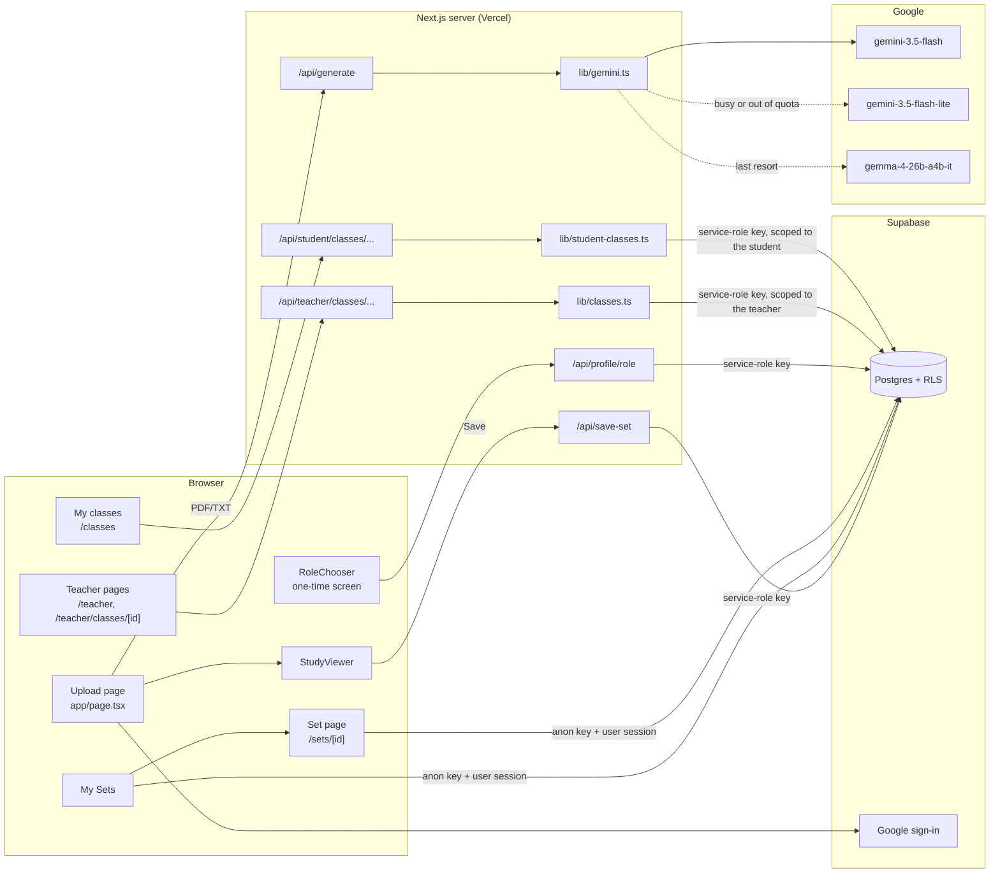

# FlashForge architecture

How the app works, end to end. For setup, see the [README](../README.md); for the
database, see [supabase/README.md](../supabase/README.md).

## Overview



Every server route that changes data checks the caller first (`lib/roles.ts`) and then
writes with the service-role key. Browsers read only what RLS allows (section 4).

### API routes

| Method and path | Who | What it does |
|---|---|---|
| `POST /api/generate` | Anyone | Extract text from a PDF/TXT and generate 10 study items (section 1) |
| `POST /api/save-set` | Signed in | Save a generated study guide to the user's account |
| `POST /api/profile/role` | Signed in, not chosen yet | One-time choice: `{ role: 'student' \| 'teacher' }` (#52) |
| `GET /api/teacher/classes` | Teacher, admin | The caller's classes, newest first, with student counts |
| `POST /api/teacher/classes` | Teacher, admin | Create a class: `{ name }` → the class with its join code |
| `GET /api/teacher/classes/[id]` | The class's teacher | Class details and roster (names, emails, join dates) |
| `PATCH /api/teacher/classes/[id]` | The class's teacher | Rename: `{ name }` |
| `DELETE /api/teacher/classes/[id]` | The class's teacher | Delete the class and its memberships |
| `POST /api/teacher/classes/[id]/join-code` | The class's teacher | Replace the join code; the old one stops working |
| `DELETE /api/teacher/classes/[id]/students/[studentId]` | The class's teacher | Remove one student from the class |
| `GET /api/student/classes` | Student | The classes the caller joined, most recent first, with teacher names |
| `POST /api/student/classes` | Student | Join with a code: `{ code }` (any case, spaces or hyphen) → 201 joined, or 200 `alreadyMember` |
| `DELETE /api/student/classes/[id]` | Student in that class | Leave the class |

Errors are JSON `{ error }` with 400 (bad input), 401 (not signed in), 403 (wrong role),
404 (not found, *or* someone else's class), 409 (conflict, e.g. a role already chosen or
the 50-class limit), 429 (too many wrong join codes; includes a `Retry-After` header), and
500 (a generic message; details only go to the server log).

## 1. Generating a study guide

1. **Upload** (`app/page.tsx`): the user picks *Flashcards* or *Multiple Choice* and
   drops a `.pdf` or `.txt` file. Nothing is saved yet.
2. **`POST /api/generate`** (`app/api/generate/route.ts`, `maxDuration = 90`):
   - Extracts text: PDFs with `unpdf`, TXT as UTF-8. Unreadable files get HTTP 422
     with a friendly message.
   - Calls `generateStudyItems(text, studyType)` and returns
     `{ title, sourceFilename, studyType, items, model }`.
   - Never sends raw API errors to the browser; details go to the server log.
3. **Show it**: the upload page swaps to `StudyViewer` on the **same URL** (`/`), so
   *Exit* clears the result instead of navigating (it asks first if the guide isn't saved).
   After 15 seconds of waiting, the page explains that a slower backup AI may be in use.
4. **Save** (optional, requires sign-in): `POST /api/save-set` verifies the user's token
   and inserts the set and cards with the **service-role** key. If the user signs in
   mid-save, the unsaved result is kept in `sessionStorage` across the Google redirect
   and saved automatically afterwards.

### The AI pipeline (`lib/gemini.ts`)

**Model chain.** Models are tried in order, and each has its own free-tier quota:

| # | Model | Attempts | Timeout per attempt | Notes |
|---|---|---|---|---|
| 1 | `gemini-3.5-flash` | 2 | 25s | Main model. `thinkingLevel: 'low'` for speed |
| 2 | `gemini-3.5-flash-lite` | 2 | 25s | Same request; separate quota |
| 3 | `gemma-4-26b-a4b-it` | 1 | 40s | Last resort: slow (~26–33s) and sometimes fails |

- The whole generation is capped at **75 seconds**.
- **429 (quota used up)** skips straight to the next model.
- **503/5xx, timeouts, network errors, and empty or invalid output** are retried with
  exponential backoff plus jitter.
- **Other 4xx errors** (bad request, bad key) fail immediately.
- Users only ever see "The AI is busy right now…" or a generic error message.

**Why Gemma needs a different request.** We tested this on 2026-10-20:

| Setting | Gemini | Gemma 4 |
|---|---|---|
| `responseSchema` | Used | HTTP 500 |
| `thinkingConfig` | `thinkingLevel: 'low'` | HTTP 400 |
| `responseJsonSchema` | Not used | Fast, but outputs garbage ("Taxonomy-set-3-A-R-C", repeated phrases, HTML) |
| Plain JSON mode | Not used | **Used.** The format goes in the prompt; Gemma "thinks" first, and those thought parts are skipped |

**Prompts.**
- *Flashcards* are identification-style: the question is a clue or definition and the
  answer is the 1–4 word term. "Explain/describe/why/how" questions aren't allowed.
- *Multiple choice*: 4 options, wrong options of the same kind as the answer, and no
  "all/none of the above". The prompt asks for 12 items so that 10 are left after
  validation.
- Only the first 30,000 characters of the file are used (#38 tracks sampling the whole
  document).

**Validation**, applied to every model's output:
- Thought parts and ```` ```json ```` fences are stripped before parsing.
- **Garbage filter:** rejects HTML, a short chunk repeated 4+ times, slug-like tokens,
  long whitespace runs, and over-long text. Flashcard answers over 8 words are dropped.
- **Multiple choice:** options are trimmed and de-duplicated, exactly 4 are required,
  the answer must match exactly one option (ignoring case and spacing, and then stored
  as that option's text), and options are shuffled in code.
- Fewer than **6** valid items counts as a failed attempt, so the next model is tried.

## 2. Auth and roles

- **Sign-in:** Google OAuth through Supabase (`lib/auth.ts`). Anyone can generate and
  study without signing in; saving requires sign-in.
- **Roles** (`public.profiles.role`): `student` (default), `teacher`, `admin`.
  - A trigger on `auth.users` creates a student profile at sign-up. It catches its own
    errors, so it can never block a sign-up.
  - Users can read their own profile and change only `display_name`, through a
    column-level grant. **They can never change their own role.**
  - The first admins come from `supabase/seed-admins.sql`; later ones will be added
    in-app (#60).
- **Choosing a role at sign-up** (#52):
  - `components/ProfileProvider.tsx` (in the root layout) loads the user's own profile,
    which RLS allows, and shares it with every page through `useProfile()`.
  - `components/RoleChooser.tsx` shows a one-time "student or teacher?" screen to any
    signed-in user who is still a default student with an empty `role_chosen_at`. That
    includes existing users on their next visit. It sits on top of the current page
    instead of navigating, so a save that's finishing after the Google redirect keeps
    running.
  - `POST /api/profile/role` accepts only `student` or `teacher`, and only once. It
    updates the row only `where role = 'student' and role_chosen_at is null`, so it can't
    overwrite a role an admin assigned, and two parallel requests can't both succeed. If
    the profile row is missing, it inserts one.
  - Responses: 401 not signed in, 400 any other role (including `admin`), 409 already
    chosen. Teachers then land on `/teacher`; students stay where they are.
- **Server checks** (`lib/roles.ts`): `requireRole(req, ['teacher', 'admin'])` reads the
  Bearer token and returns the user, or throws `AuthError` with 401 (not signed in) or
  403 (wrong role). A user without a profile counts as a student. Every teacher and
  admin route must use it, because hiding UI is not protection.

### Classes (#53)

- Teachers (and admins) create classes on `/teacher`. Each class gets a **join code**:
  6 characters from an alphabet without look-alikes (no `0/O`, `1/I/L`), stored as
  `K7M2QX` and shown as `K7M-2QX`. A unique constraint guarantees one class per code;
  on a clash the server simply tries a new random code.
- **All class changes go through `/api/teacher/classes/...`** routes, which call
  `requireRole(req, ['teacher', 'admin'])` and then `lib/classes.ts`. Every query there
  filters on `teacher_id = <caller>`, so another teacher's class behaves exactly like a
  missing one (404). There are no write grants or policies for browsers.
- **Get a new code** replaces it right away. The old code stops working, and students
  already in the class stay in it.
- The roster (names **and emails**) comes from `public.class_roster(class, teacher)`, a
  database function only the service role may call. It returns nothing unless the
  teacher owns the class.
- A teacher can have at most 50 classes (`MAX_CLASSES_PER_TEACHER`), since anyone can
  pick "teacher" at sign-up.
- **Admins** can use all teacher features, but only on classes they created themselves.
  Seeing other teachers' classes would be an admin feature (#60/#61).

### Joining a class (#54)

- Students open **My classes** (`/classes`, linked in the upload page header) and type a
  code. Case, spaces and the hyphen don't matter (`k7m 2qx` → `K7M2QX`, using
  `normalizeJoinCode`). Before joining, the page says: *"Your teacher will see your name,
  email, and your scores on this class's assignments."*
- `POST /api/student/classes` looks the code up on the server, with the service role. So
  codes can't be listed or guessed through the database API: browsers have no access to
  other classes' rows at all.
- **Students only:** teachers and admins get 403 (they manage classes, they don't join them).
- **Joining twice changes nothing.** The (`class_id`, `student_id`) primary key rejects
  the second row, which the route reports as `alreadyMember`.
- **Guessing limit:** each wrong code (a valid format, but no class has it) is saved in
  `class_join_failures`. After **10 wrong codes in 15 minutes**, the route answers 429
  until the oldest one falls out of the window. That's checked *before* the lookup, so
  even a correct code waits. Codes with an impossible format are rejected (400) without
  counting. This is stored in the database because Vercel runs many server instances
  that don't share memory.
- **Leaving** (`DELETE /api/student/classes/[id]`) removes only the caller's own
  membership. Rejoining needs the class's current code.

The plan for teacher and admin features is tracked in #50.

## 3. Data model

| Table | Columns | Notes |
|---|---|---|
| `flashcard_sets` | `id`, `user_id` → `auth.users`, `title`, `source_filename`, `study_type`, `created_at` | `user_id` is null for legacy sets made before sign-in was required |
| `flashcards` | `id`, `set_id` → `flashcard_sets` (cascade), `question`, `answer`, `options` (jsonb, MC only), `position` | Indexed on `set_id` |
| `profiles` | `id` → `auth.users` (cascade), `display_name`, `role`, `role_chosen_at`, `created_at` | `role_chosen_at` is for the sign-up role choice (#52) |
| `classes` | `id`, `teacher_id` → `auth.users` (cascade), `name` (1–80 chars), `join_code` (unique), `created_at` | Indexed on `teacher_id` |
| `class_members` | `class_id` → `classes` (cascade), `student_id` → `auth.users` (cascade), `joined_at` | Primary key (`class_id`, `student_id`); indexed on `student_id` |
| `class_join_failures` | `id`, `user_id` → `auth.users` (cascade), `attempted_at` | Wrong join codes for the rate limit; indexed on (`user_id`, `attempted_at`); old rows are deleted as new ones arrive |

## 4. Security model

**Two Supabase keys:**
- The **anon key** is public and used in the browser. What it can do is limited entirely
  by Row Level Security.
- The **service-role key** bypasses RLS. It's only used in `lib/supabase-admin.ts` and
  must never be imported by client code.

**RLS policies** (as of 2026-10-20):

| Table | Who | Can |
|---|---|---|
| `flashcard_sets` | Owner | Read, rename, delete their own sets |
| `flashcard_sets` | Anyone | Read legacy sets with no owner |
| `flashcard_sets` | Anyone | **Insert: nobody** (saves go through `/api/save-set`) |
| `flashcards` | Anyone | Read cards whose set they can read; no direct writes |
| `profiles` | The user | Read their own row and update `display_name` only; anon has no access |
| `classes` | Teacher / members | The teacher reads their own classes; members read classes they joined; no direct writes |
| `class_members` | Student / teacher | A student reads their own memberships; the teacher reads their roster; no direct writes (joining and leaving go through the server) |
| `class_join_failures` | Nobody | Server-only: no grants or policies for anon or signed-in users |

The `classes` and `class_members` policies need to check each other, which would make RLS
recurse. So they use `private.is_class_teacher()` and `private.is_class_member()`:
security-definer helpers in a schema the API doesn't expose.

**Two holes fixed on 2026-10-20 (#46):**
- An anon policy exposed **every** card, including private ones.
- An insert policy allowed **anyone** to insert sets with any `user_id`.

`supabase/tests/*.sql` re-checks these rules by simulating users inside a rolled-back
transaction. Run them after every database change.

## 5. Testing

- `npm test`: Vitest.
  - Unit and route tests for roles, `/api/profile/role` and the class API, using
    `test-utils/fake-supabase.ts`. That's an in-memory client with unique keys (23505)
    and cascading deletes.
  - Component tests for `RoleChooser` and the teacher pages, in jsdom with React Testing
    Library. Component tests start with `// @vitest-environment jsdom`.
- `supabase/tests/*-rls-check.sql`: database security checks for sets, profiles and
  classes. Each prints expected vs. actual (10, 10 and 21 cases).
- AI changes were checked with mocked `fetch` (retries, fallbacks, validation) and a few
  real API calls. Keep real calls to a minimum because of the 20-requests-a-day quota.

## Known limitations

- **Free-tier AI quota:** about 20 requests a day on `gemini-3.5-flash`, shared by
  everyone. The backups help, but a paid tier is being discussed in #45.
- **`/api/generate` has no rate limit yet** (#41 and #63), so anyone can use up the quota.
- **Legacy sets with no owner (28 of them) are publicly readable.**
- **Text extraction:** only the first 30,000 characters are used (#38), PDFs are
  uploaded to the server whole (#44), and only PDF and TXT are supported (#20).
- **3 existing ESLint errors** (`react-hooks/set-state-in-effect`) in `app/page.tsx` and
  `app/my-sets/page.tsx`.
- **The join-code guessing limit is per account** (10 wrong codes per 15 minutes).
  Someone with many Google accounts could guess faster. With about 887 million possible
  codes, that's still impractical, and #63 will add wider rate limits.
- **Open dependency advisories** (`npm audit`, 2026-10-20):
  - **`next` 16.3.3** (used by the live site) has published advisories. They include a
    critical remote-code-execution bug in `next/og` and a high-severity SSRF in image
    optimization. FlashForge doesn't use `next/og`, `next/image` or an `images`
    config, so it's likely not exploitable, but the fix is to upgrade to **16.3.8**
    (along with `eslint-config-next`). This hasn't been done yet.
  - **Dev tools only:** `vitest` 3.2.7 still pulls in `tinypool` and `@vitest/mocker`
    advisories, and `eslint-config-next` pulls in `fast-glob`, `micromatch` and
    `braces` advisories. These only matter if someone controls our test or lint config,
    and fixing them needs major-version upgrades.
